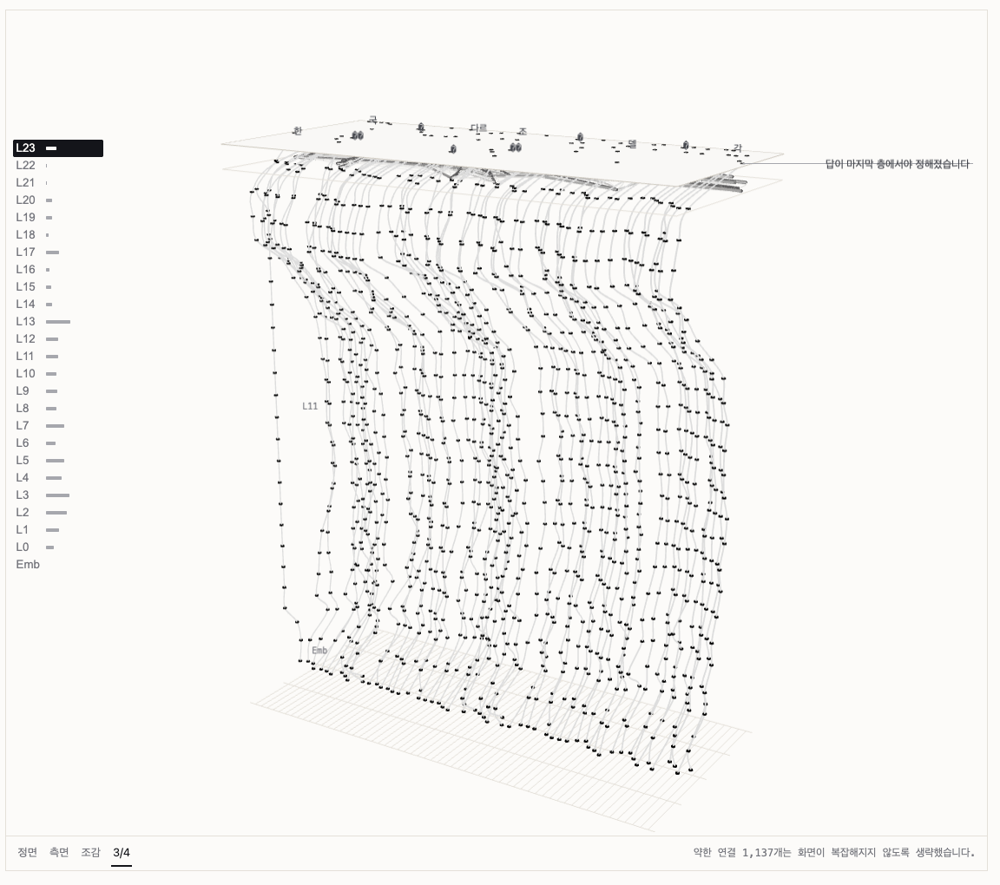
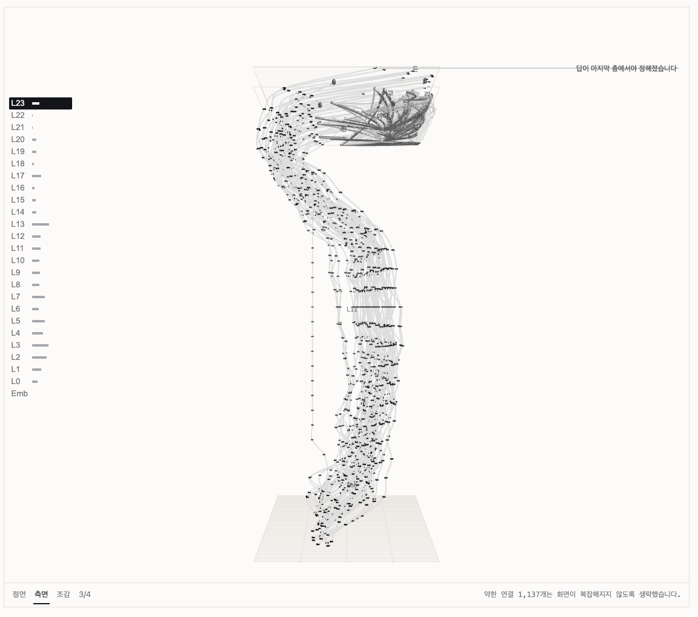
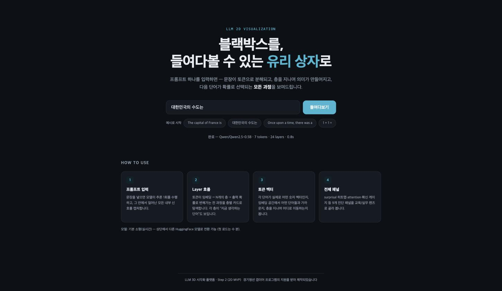
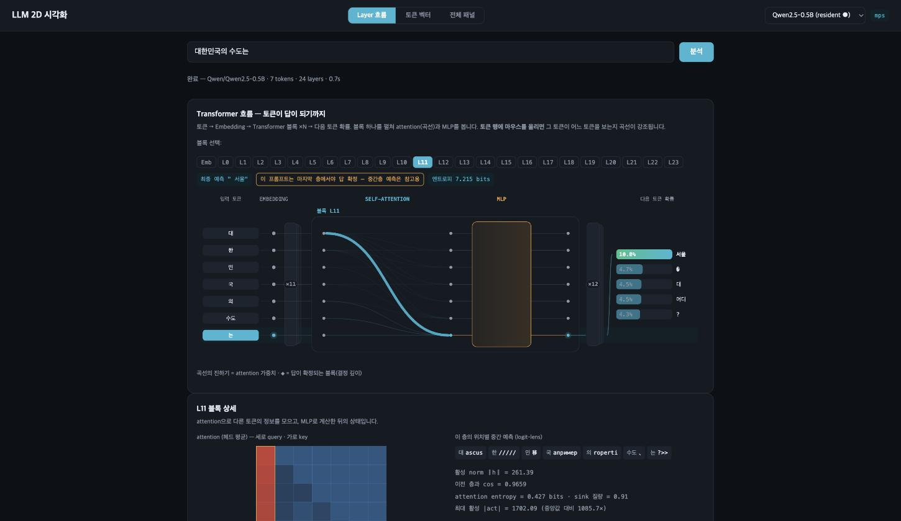
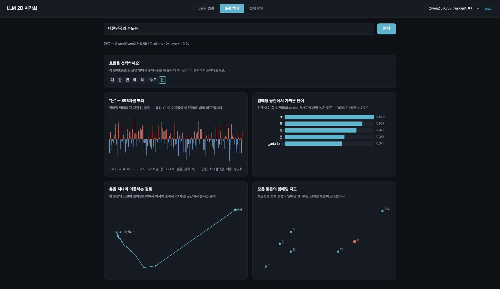

# LLM 시각화 — 답이 만들어지는 과정을 층 단위로 본다

문장을 넣으면 LLM이 답을 내놓기까지 내부에서 무슨 일이 일어나는지를 눈으로 따라가는 도구입니다.
모델에서 실제로 측정한 값만 씁니다. 추정하거나 꾸며낸 수치는 없습니다.

이 저장소에는 **3D 뷰**가 들어 있습니다. 서버 없이 정적 파일만으로 돌아갑니다.



---

## 바로 띄워보기

```bash
git clone https://github.com/gnssl98/llm_visualization.git
cd llm_visualization/web
python3 -m http.server 8000
```

브라우저에서 `http://127.0.0.1:8000/index.html` 를 엽니다.
빌드도, 설치도, 네트워크도 필요 없습니다. three.js는 저장소에 포함돼 있습니다.

다른 장면을 보려면 주소 뒤에 픽스처를 붙입니다.

| 주소 | 내용 |
|---|---|
| `?fixture=./fixtures/qwen05b.json` | 기본값. Qwen2.5-0.5B, 24층 × 59토큰 |
| `?fixture=./fixtures/qwen05b_short_ko.json` | "대한민국의 수도는" 7토큰 |
| `?fixture=./fixtures/qwen05b_short_en.json` | "The capital of France is" 5토큰. 답이 L22에서 굳는 장면 |
| `?fixture=./fixtures/synthetic32b.json` | 64층 × 96토큰. 큰 모델에서 화면이 버티는지 보는 합성 데이터 |
| `…&debug=1` | 상태 줄에 노드 수·draw call 같은 개발용 수치 표시 |

---

## 화면 읽는 법

세 축이 각각 다른 것을 뜻합니다.

```
        Y (층)
        ↑  L23  ← 여기서 답이 나온다
        │   ⋮
        │  Emb  ← 바닥
        └──────────→ X (토큰 순서, 문장 읽는 방향)
       ╱
      Z (의미 축, 앞뒤)
```

- **세로로 흐르는 선** — 토큰 하나가 층을 지나며 의미 축에서 어디로 움직였는지입니다.
  2D에서는 층을 한 번에 하나씩만 볼 수 있어서, 이 경로 전체가 한눈에 안 들어옵니다.
  3D로 만든 이유가 이것입니다.
- **가로로 걸린 아치** — 그 층에서 어떤 토큰이 어떤 토큰을 보고 있는지(attention)입니다.
  굵기가 가중치이고, 약한 연결은 화면이 복잡해지지 않게 생략합니다. 생략한 개수는 아래에 적힙니다.
- **보라색 기준선** — 답이 확정되는 층입니다. 그 위로는 마지막 토큰의 궤적 색이 바뀝니다.
  모델이 끝까지 확신하지 못하면 선을 그리지 않고 "답이 마지막 층에서야 정해졌습니다"라고 적습니다.
  화면에 없는 사건을 있는 것처럼 그리지 않기 위해서입니다.
- **왼쪽 레일** — 층 목록입니다. 막대는 그 층의 top-1 확률이고, 클릭하면 초점이 옮겨갑니다.
  층이 많아지면 목록 대신 연속 축으로 자동 전환됩니다.

측면에서 보면 궤적이 얼마나 휘었는지가 드러납니다.



**조작** — 좌클릭 드래그로 회전, 우클릭 드래그로 줌, 숫자키 1·2·3으로 시점 전환.
휠은 페이지 스크롤로 남겨뒀습니다. 화면 위에서 휠을 굴렸는데 씬이 확대되면 성가시기 때문입니다.
마우스 없이 키보드만으로도 층과 토큰을 옮길 수 있고, WebGL이 없는 환경에서는 같은 내용을 표로 봅니다.

---

## 데이터는 어디서 왔나

`web/fixtures/` 의 JSON은 **실제 모델을 돌려 뽑은 값**입니다. 추출·검증 엔진은 이 저장소에
없지만(모델 가중치와 GPU가 필요합니다), 그 출력은 그대로 들어 있습니다.

- `qwen05b*.json` — [Qwen2.5-0.5B-Instruct](https://huggingface.co/Qwen/Qwen2.5-0.5B-Instruct) 실측
- `synthetic32b*.json` — 64층 × 96토큰 합성 데이터. 큰 모델에서 레이아웃과 성능이
  버티는지 보려고 만든 것이라 내용에는 의미가 없습니다
- `fixtures/attn/` — 층별 attention을 미리 구워둔 파일 88개. 원래는 서버가 요청마다
  계산하던 것인데, 정적 호스팅에서도 엣지가 보이도록 덤프해 뒀습니다
  (`tools/dump_attention.py`)

---

## 2D 뷰

같은 데이터를 평면으로 보는 화면도 만들었습니다. 이쪽은 문장을 입력하면 그 자리에서
모델을 돌리는 구조라 서버가 필요해서, 이 저장소에는 포함하지 않았습니다.

| 입력 화면 | Layer 흐름 | 토큰 벡터 |
|---|---|---|
|  |  |  |

가운데가 핵심 화면입니다. 입력 토큰이 Embedding을 거쳐 Transformer 블록들을 지나
다음 단어 확률로 나오기까지가 한 줄에 놓이고, 블록을 누르면 그 층이 무슨 단어를
떠올리고 있었는지(logit-lens)를 볼 수 있습니다.

A100 80GB에서 14B·32B 모델까지 올려 확인했습니다. 32B는 받아서 적재하고 분석하는
전 과정이 2분이 채 안 걸렸고, 그 뒤로는 분석이 초 단위로 끝났습니다.

---

## 구조

```
web/
  index.html
  css/            tokens.css(색·간격 토큰) + stage.css
  js/3d/          씬 구성 모듈
    coords.js       좌표계·정규화. three를 import하지 않아 Node에서 바로 검증된다
    nodes.js        층×토큰 노드 (InstancedMesh 1개로 6,240개)
    trails.js       세로 궤적
    edges.js        attention 아치
    decor.js        층 평면·바닥 그리드·결정 기준선
    labels.js       DOM 라벨 (3D 공간에 텍스트를 그리지 않는다)
    rail.js         왼쪽 층 레일
    main.js         씬 조립·상태 머신
  fixtures/       분석 결과 JSON + 층별 attention 덤프
  assets/vendor/  three.js r185 오프라인 번들

docs/
  03_3D_구현_사양서.md   좌표계·시각 인코딩·인터랙션 규칙 전문
  screenshots/

LICENSE             MIT. 번들한 three.js·픽스처 출처도 여기 적어뒀다

tools/
  test_coords.mjs        좌표계 검증 (브라우저 없이 Node로)
  test_edges.mjs         엣지 굵기 양자화 검증
  test_perf.mjs          성능 감축 로직 검증
  dump_attention.py      attention 정적 덤프 생성
```

---

## 만들면서 정한 규칙들

화면을 그리기 전에 `docs/03_3D_구현_사양서.md`에 규칙을 먼저 정했습니다. 3D는 잘못 만들면
보기만 좋고 읽히지는 않는 화면이 되기 쉬워서, 그걸 걸러낼 기준도 같이 적어뒀습니다.
예를 들면 *화면을 10초 보고 어느 층에서 답이 정해졌는지 말할 수 있는가* 같은 것들입니다.

실제로 다 만든 뒤 그 기준으로 스스로 점검했더니 고칠 곳이 14군데 나왔습니다. 그중 하나는
이런 것이었습니다. 토큰이 많아질수록 옆에서 본 입체가 납작해져서, 59토큰에서는 가로:깊이가
10.7:1이 되어 거의 판자처럼 보였습니다. 색이나 간격 규칙은 다 지켜져 있었는데도 그랬습니다.
토큰 수에 따라 간격이 스스로 조정되도록 좌표 규칙을 고쳐 2.2:1로 줄였고, 같은 문제가
다시 생기면 바로 걸리도록 `tools/test_coords.mjs`에 회귀 테스트로 박아뒀습니다.

```bash
node tools/test_coords.mjs   # 좌표계
node tools/test_edges.mjs    # 엣지 굵기
node tools/test_perf.mjs     # 성능 감축
```

three.js를 import하지 않는 순수 함수로 떼어둔 덕분에 브라우저 없이 돌아갑니다.

---

## 현재 상태

사양서에 10단계를 잡아두고 7단계까지 왔습니다.

- 구현됨 — 씬·노드·궤적·attention 엣지·인터랙션·결정 깊이 연출·키보드 접근성·표 대체 뷰·저사양 자동 감축
- 남은 것 — 데모 영상, 랜딩 화면, 2D 뷰와의 연결

---

## 출처와 라이선스

MIT. 자세한 내용과 third-party 출처는 [LICENSE](LICENSE)에 있습니다.

- [three.js](https://threejs.org) r185 (MIT) — `web/assets/vendor/`에 번들로 포함
- 픽스처는 [Qwen2.5-0.5B-Instruct](https://huggingface.co/Qwen/Qwen2.5-0.5B-Instruct) (Apache 2.0) 출력에서 파생

2026 경기청년 갭이어 프로그램의 지원을 받아 제작되었습니다.
